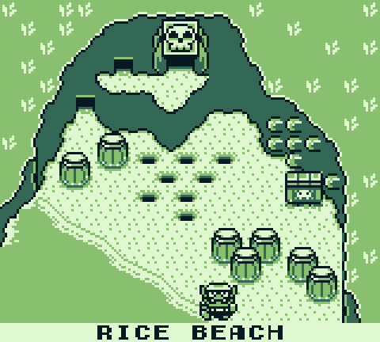

# Wario Land: Super Mario Land 3 — Static Recompilation

Static recompilation of **Wario Land: Super Mario Land 3** (Nintendo, 1994) from its Game Boy cartridge to native C.
The game's SM83 machine code is translated ahead of time into C and built into
one native `rom.exe`. No emulator runs the game; a small fallback interpreter
only covers jumps the static analyser couldn't resolve.

Built on [gb-recompiled](https://github.com/sp00nznet/gb-recompiled), the same
toolchain as [Link's Awakening](https://github.com/sp00nznet/LinksAwakening),
[Pokémon](https://github.com/sp00nznet/pokemon) and
[Pokémon Gold](https://github.com/sp00nznet/pokemon-gold). Its Game Boy
siblings: [Super Mario Land](https://github.com/sp00nznet/supermarioland-recomp), [Super Mario Land 2](https://github.com/sp00nznet/supermarioland2-recomp).

**You need your own copy of the game.** No ROM, and nothing generated from
one, is in this repository.



From the Rice Beach map into the first course, Wario walking and shoulder-bashing, every frame drawn by the recompiled game.

## Status: **boots and plays.** First bring-up; not yet played through.

| Stage | State |
|---|---|
| Cartridge | MBC1 + RAM + battery, 512 KB, original Game Boy (DMG) |
| Recompile | 57,231 blocks, 6,472 functions; 2 oversized functions sent to the interpreter |
| Boot | DMG power-on state (`GB_MODEL_DMG`), so the game sees an original Game Boy |
| Reached | The intro on the boat, the file-select screen, the Rice Beach map, the first course: Wario walking, jumping and shoulder-bashing |
| Not yet checked | A full playthrough, battery saves surviving a restart, audio against the original |

## Building

### What you need

- **Windows 11**: Visual Studio 2022 Build Tools (C++), CMake 3.20 or newer,
  SDL2 from [vcpkg](https://github.com/microsoft/vcpkg) (`vcpkg install sdl2:x64-windows`).
- **The ROM**, dumped from your own cartridge, in `roms/`. Tested with:
  `Wario Land - Super Mario Land 3.gb`, SHA-1 `ae65800302438e37a99e623a71d1c954d73c843e`.

### Build

```bash
git clone --recurse-submodules https://github.com/sp00nznet/warioland-recomp.git
cd warioland-recomp

# 1) build the recompiler (once)
cmake -S gbrecomp -B gbrecomp/build -DCMAKE_TOOLCHAIN_FILE=C:/vcpkg/scripts/buildsystems/vcpkg.cmake
cmake --build gbrecomp/build --target gbrecomp --config Release

# 2) recompile your ROM into generated/
mkdir generated
cp "roms/Wario Land - Super Mario Land 3.gb" generated/rom.gb
gbrecomp/build/bin/Release/gbrecomp.exe generated/rom.gb -o generated
rm generated/CMakeLists.txt generated/rom_main.c   # this repo ships its own

# 3) build and play
cmake -S . -B build -DCMAKE_TOOLCHAIN_FILE=C:/vcpkg/scripts/buildsystems/vcpkg.cmake
cmake --build build --config Release
./build/Release/rom.exe
```

### Controls and flags

Arrows or WASD move, Z or J is A, X or K is B, Enter is Start, Right Shift or
Backspace is Select (all rebindable). A gamepad
works too, and the menu bar has settings, scaling, palettes and save states.

| Flag | Effect |
|---|---|
| `--input "frame:buttons:duration,..."` | Scripted input (buttons `U D L R A B S T`, T is Select) |
| `--dump-frames 100,200,...` | Save those frames as `.ppm` (up to 100) |
| `--screenshot-prefix name` | File prefix for dumped frames (keep it short) |

## Layout

| Path | What it is |
|---|---|
| `rom_main.c` | Entry point: DMG boot, the SDL window, the frame loop |
| `CMakeLists.txt` | Builds the runtime from `gbrecomp/` and the game from `generated/` |
| `gbrecomp/` | [gb-recompiled](https://github.com/sp00nznet/gb-recompiled) (submodule): recompiler and runtime |
| `generated/` | Your recompiled ROM (git-ignored, made in step 2) |

## Legal

Wario Land: Super Mario Land 3 is © Nintendo. This project contains no game code or data and is
not affiliated with or endorsed by Nintendo. The code here is MIT-licensed
([LICENSE](LICENSE)).
